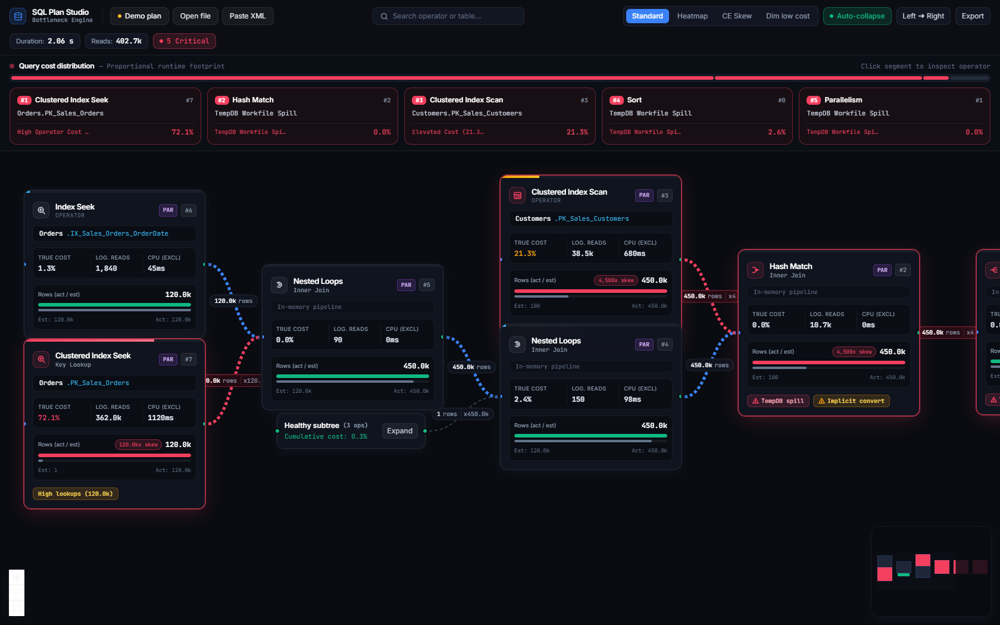
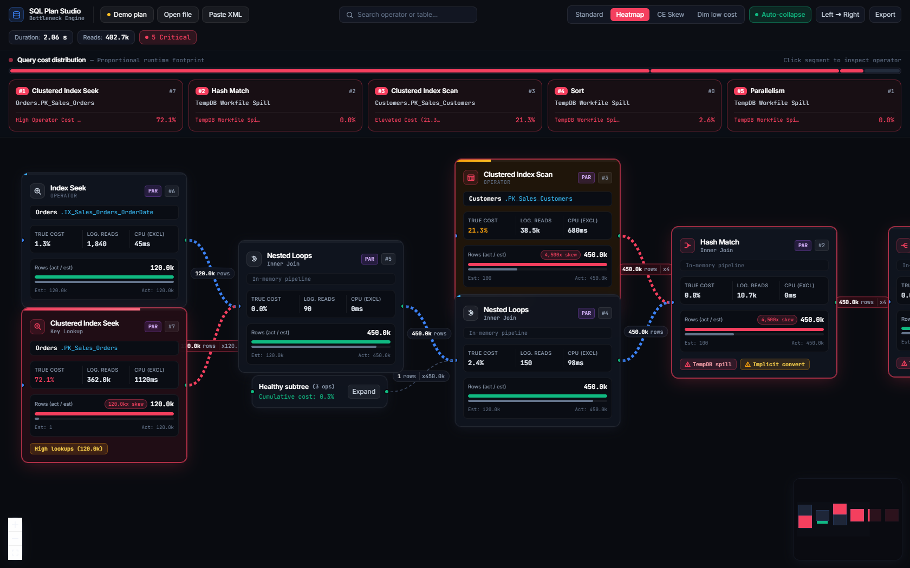
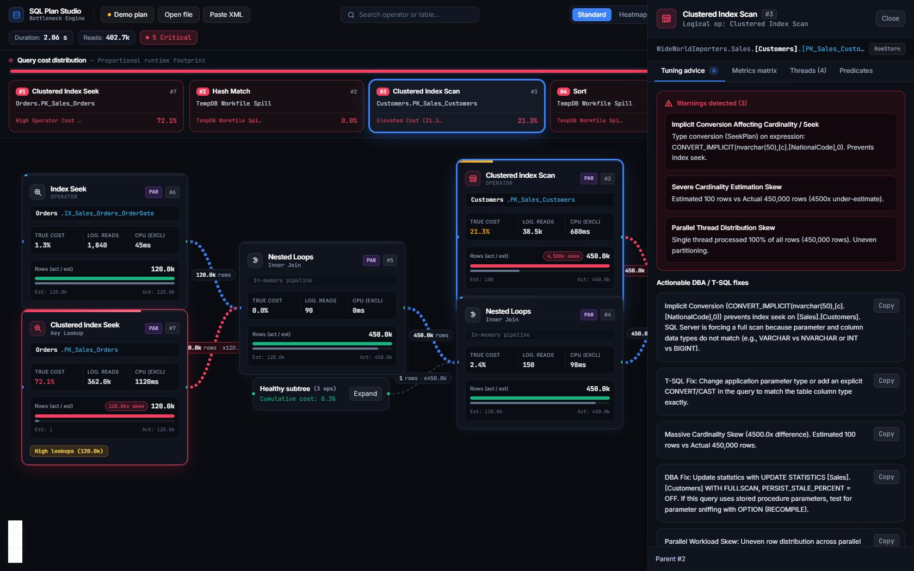

<div align="center">

# SQL Plan Studio
### Modern SQL Server Execution Plan Visualizer & Bottleneck Engine

**A modern, high-density SQL Server Execution Plan visualizer and query tuning workbench designed to replace the legacy SSMS plan viewer.**

[](LICENSE)
[](https://reactjs.org/)
[](https://www.typescriptlang.org/)
[](https://vitejs.dev/)
[](https://tailwindcss.com/)
[](https://reymit.ir/lilarmn)
[](CONTRIBUTING.md)

<br />

[Features](#-key-features) •
[Why Not Native SSMS?](#-why-native-ssms-viewer-fails) •
[Interactive Walkthrough](#-feature-deep-dive) •
[Architecture](#-architecture) •
[Getting Started](#-getting-started) •
[Engine Heuristics](#-anti-patterns-detected) •
[Support / دونیت](#-support--حمایت-مالی)

<br />



</div>

<br />

---

## ⚡ Why Native SSMS Viewer Fails

The built-in SQL Server Management Studio (SSMS) Execution Plan viewer was designed over two decades ago and contains critical engineering limitations that mislead database administrators and software engineers:

| Limitation in Native SSMS | How SQL Plan Studio Solves It |
| :--- | :--- |
| **Estimated Cost Illusion**<br>Native SSMS calculates "Operator Cost %" using *Estimated Subtree Cost*, even when viewing an *Actual Execution Plan*. A node displaying 80% cost may have executed in 2ms, while a 0% node burned 90% of total query runtime. | **True Exclusive Runtime Cost**<br>Recalculates True Actual Cost % by isolating each operator's exclusive CPU milliseconds and Logical Storage Reads relative to the entire query runtime. |
| **Massive Tree Clutter**<br>Complex stored procedures and view hierarchies produce 80–150+ node sprawling graphs that require endless horizontal scrolling and manual inspection. | **Auto-Collapse Healthy Subtrees**<br>Identifies low-cost subtrees (&ge; 3 nodes, cumulative cost &lt; 2%, zero warnings) and auto-collapses them into compact abstraction badges. |
| **Buried Engine Warnings**<br>Devastating runtime hazards (TempDB spills, implicit type conversions, massive CE skews) are hidden inside tiny tooltips. | **High-Visibility Radar & Badges**<br>Surface anti-pattern chips with direct visual indicators, ranked bottleneck radar, and a proportional flame strip. |
| **No Remediation Guidance**<br>SSMS displays the symptom but provides zero DBA tuning advice or remediation steps. | **Actionable DBA / T-SQL Advice**<br>Generates concrete, copyable T-SQL statements (e.g., `UPDATE STATISTICS WITH FULLSCAN`, covering index syntax, matching parameter types). |

---

## 📸 Feature Deep Dive

### 1. Proportional Query Cost Distribution Strip & Bottleneck Radar
Instantly pinpoint where 100% of query runtime was spent. The interactive flame strip divides execution time proportionally across all query operators. Clicking any segment automatically focuses and centers that operator on the canvas.

<div align="center">
  
</div>

<br />

### 2. Slide-Over Diagnostic Inspector & Actionable T-SQL Fixes
Select any operator to open the high-density diagnostic drawer. View side-by-side metric matrices (Actual vs. Estimated), examine parallel thread distribution skews, and copy tested T-SQL index or query adjustments directly to your clipboard.

<div align="center">
  
</div>

---

## 🛠 Key Features

- **DOMParser ShowPlanXML Engine (`showplanParser.ts`):** Ingests raw `.sqlplan` XML natively in the browser without server roundtrips. Parses runtime threads, memory grants, wait stats, seek predicates, and target indexes.
- **Exclusive Cost Calculation:** Accurately isolates parent-child execution overhead, handling blocking vs. streaming operators (Hash Join vs. Nested Loops).
- **Logarithmic Flow Conduits:** Variable-bore bezier conduits dynamically scale pipe thickness from 1.5px to 5px based on actual row throughput with animated directional particles.
- **In-Plan Fast Search (`Ctrl+F`):** Search operators by physical op, logical op, table, or index name with match counter and keyboard navigation.
- **Segmented View Modes:**
  - `Standard`: Clean high-density diagram.
  - `Heatmap`: Color-coded by true CPU and I/O consumption.
  - `CE Skew`: Pinpoints cardinality estimation discrepancies.
  - `Dim Low Cost`: Dims healthy nodes to isolate bottleneck paths.
- **Dual Flow Layout:** Toggle between **Data Flow (Left to Right)** and **SSMS Standard (Right to Left)** with one click.
- **Export Diagnostic Reports:** Download complete bottleneck audits as structured JSON for team reviews and CI/CD benchmarks.

---

## 🧠 Anti-Patterns Detected

| Warning Type | Severity | Engine Condition | Actionable Remediation |
| :--- | :---: | :--- | :--- |
| **TempDB Spill** | `CRITICAL` | Sort or Hash Match operator ran out of memory grant and spilled execution rows to TempDB storage. | Update statistics with fullscan, adjust memory grant hints (`MIN_GRANT_PERCENT`), or add a supporting index. |
| **Implicit Conversion** | `CRITICAL` | `CONVERT_IMPLICIT` applied to a filtered table column, forcing a clustered index scan instead of an index seek. | Align parameter and application variable data types with table column definitions (e.g., `VARCHAR` vs `NVARCHAR`). |
| **Cardinality Skew** | `CRITICAL` / `WARNING` | Optimizer estimated vs. runtime row count delta exceeds 10x with &gt; 1,000 rows. | Update stale table statistics or create filtered statistics to resolve parameter sniffing or correlation skews. |
| **Excessive Key Lookups** | `WARNING` | Non-clustered index seek followed by &gt; 100 executions of Key/RID lookups on the base clustered index. | Create a covering index using `INCLUDE (col1, col2)` to eliminate point lookups. |
| **Parallel Thread Skew** | `WARNING` | Workload unevenly distributed across threads (e.g., Thread 0 processed &gt; 90% of rows while other threads sat idle). | Resolve data distribution skews or evaluate `MAXDOP` settings. |
| **Missing Join Predicate** | `CRITICAL` | Query executed an unintentional Cartesian cross product between tables. | Add explicit `ON` join predicates or evaluate subquery correlations. |

---

## 🏗 Architecture

```
                               ┌─────────────────────────────────┐
                               │     Raw .sqlplan XML Source     │
                               │   (File Drop / Paste / SSMS)    │
                               └────────────────▲────────────────┘
                                                │
                                                ▼
                               ┌─────────────────────────────────┐
                               │   ShowPlanXML Browser Parser    │
                               │   - Native DOMParser Engine     │
                               │   - Thread Metrics Accumulation │
                               │   - Exclusive Cost Isolation    │
                               └────────────────▲────────────────┘
                                                │
                                                ▼
                               ┌─────────────────────────────────┐
                               │   Heuristic Bottleneck Engine   │
                               │   - True Cost % Scoring (0-100) │
                               │   - CE Skew Ratio Calculation   │
                               │   - Anti-Pattern Diagnosis      │
                               │   - Auto-Collapse Evaluator     │
                               └────────────────▲────────────────┘
                                                │
                                                ▼
       ┌─────────────────────────────────────────────────────────────────────────────────┐
       │                                Modern Frontend UI                               │
       │                                                                                 │
       │   ┌─────────────────────┐   ┌─────────────────────┐   ┌─────────────────────┐   │
       │   │  Studio Top Header  │   │  Proportional Flame │   │   Pipeline Canvas   │   │
       │   │  - Plan Search      │   │  - Cost Allocator   │   │   - React Flow      │   │
       │   │  - View Filters     │   │  - Top Bottlenecks  │   │   - Dagre Layout    │   │
       │   │  - Layout Direction │   │  - Quick Jump       │   │   - Custom Nodes    │   │
       │   └─────────────────────┘   └─────────────────────┘   └─────────────────────┘   │
       │                                                                                 │
       │   ┌─────────────────────────────────────────────────────────────────────────┐   │
       │   │                         Slide-Over Node Inspector                       │   │
       │   │   [Tuning Advice]    [Metrics Matrix]    [Parallel Threads]    [Preds]  │   │
       │   └─────────────────────────────────────────────────────────────────────────┘   │
       └─────────────────────────────────────────────────────────────────────────────────┘
```

---

## 🚀 Getting Started

### Prerequisites
- [Node.js](https://nodejs.org/) (v18.0 or later)
- Modern web browser (Chrome, Edge, Firefox, Safari)

### Installation & Run

1. **Clone the repository:**
   ```bash
   git clone https://github.com/Lilarmn/modern-sqlplan-visualizer.git
   cd modern-sqlplan-visualizer
   ```

2. **Install dependencies:**
   ```bash
   npm install
   ```

3. **Start the development server:**
   ```bash
   npm run dev
   ```

4. **Open in browser:**
   Navigate to [http://localhost:3000](http://localhost:3000).

> **Windows Quick Launch:** Double-click [`Run-PlanVisualizer-Web.bat`](Run-PlanVisualizer-Web.bat) to launch the dev server and open your browser automatically.

---

## ⌨️ Pro Tips & Shortcuts

- **Find in Plan (`Find` Bar):** Type any table name (e.g. `Orders`), index name, operator name (e.g. `Hash Match`), or node ID (`#3`) to cycle through matching operators.
- **Ruler Quick Jump:** Click any segment in the top **Query cost distribution** strip to immediately focus and zoom to that operator.
- **Inspect Operator:** Click any operator card on the canvas to open the detailed diagnostic drawer.
- **Copy T-SQL Fix:** Click the `Copy` button inside the Inspector to copy ready-to-run DBA index and query scripts.
- **Auto-Collapse Toggle:** Turn off `Auto-collapse` in the toolbar to inspect every node in low-cost dimension lookup subtrees.

---

## 📦 Tech Stack

- **Framework:** [React 18](https://react.dev/) + [TypeScript](https://www.typescriptlang.org/)
- **Graph Visualization:** [@xyflow/react](https://reactflow.dev/) (React Flow v12) + [Dagre](https://github.com/dagrejs/dagre)
- **Styling:** [Tailwind CSS v3.4](https://tailwindcss.com/)
- **Build Tool:** [Vite v5](https://vitejs.dev/)
- **Host Bridge (Optional):** .NET Framework 4.8.1 VSIX Extension for SSMS 19/20 via Microsoft Edge WebView2

---

## ☕ Support / حمایت مالی

اگر این ابزار به بهینه‌سازی کوئری‌های SQL شما کمک کرده یا در عیب‌یابی پلن‌های اجرایی پیچیده مفید بوده است، می‌توانید از توسعه و نگهداری مداوم آن حمایت کنید:

<div align="center">
  <a href="https://reymit.ir/lilarmn" target="_blank">
    
  </a>
  <br />
  <p><strong>لینک درگاه حمایت ریالی (کارت‌های عضو شتاب):</strong> <a href="https://reymit.ir/lilarmn">https://reymit.ir/lilarmn</a></p>
</div>

---

## 📄 License

This project is licensed under the MIT License - see the [LICENSE](LICENSE) file for details.

---

<div align="center">
  <sub>Built with precision for database administrators, data engineers, and SQL Server performance architects.</sub>
</div>
